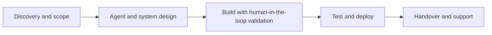
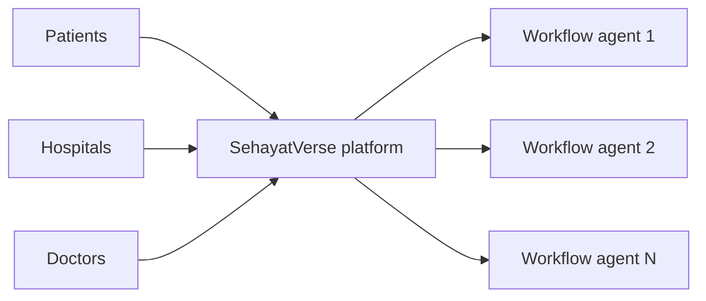
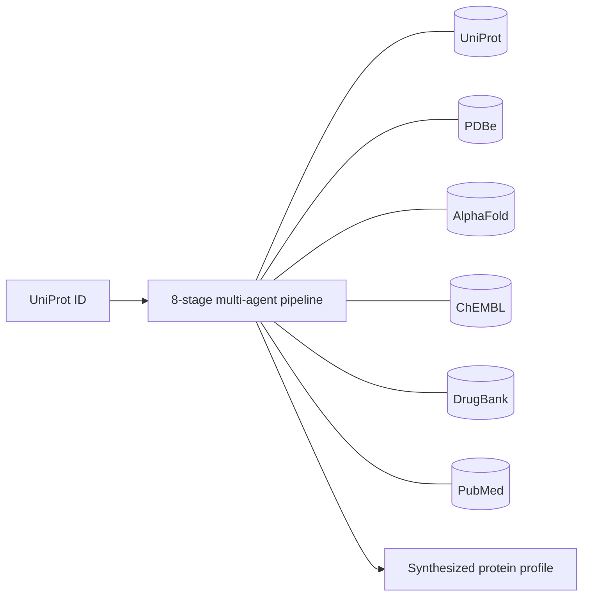
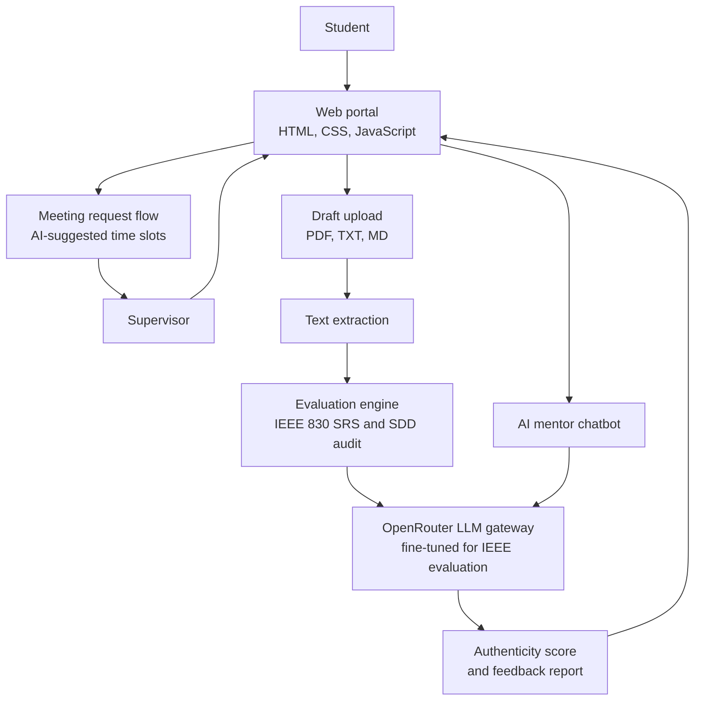
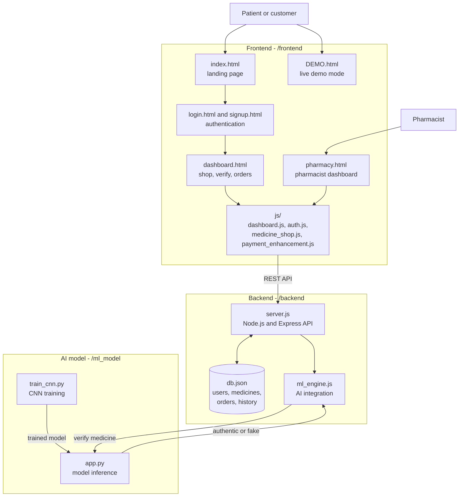
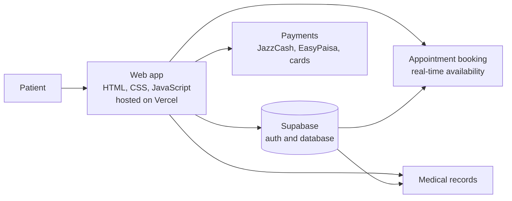

## 👋 About me

I’m an **Agentic AI Engineer** with **4+ years** of experience designing, building and deploying **production-grade autonomous multi-agent systems** with LangChain, LangGraph, CrewAI and AutoGen.

- 🎓 Currently: **AI Instructor** at NAVTTC Centre of Excellence in Modern Technologies
- 🚀 Live products: **SehayatVerse**, **UniProtXplore**, **Smart Supervisor**, **Autonomous Fake Medicine Detection** and **MediConnect**
- 🤝 Open to: **AI engineering roles, freelance projects and collaborations**
- 💬 Ask me about: multi-agent orchestration, RAG pipelines, agentic coding workflows, deploying AI as SaaS

**Connect:** [LinkedIn](https://www.linkedin.com/in/zareen-fatima-596552283/), [Portfolio](https://ZareenFatima-tech.github.io), [Email](mailto:zareenfatima114@gmail.com), [write via Gmail](https://mail.google.com/mail/?view=cm&fs=1&to=zareenfatima114@gmail.com)

---

## 📈 Impact at a glance

| Metric | Result |
|---|---|
| **Years of experience** | 4+ |
| **AI products shipped** | 10+ |
| **Teams led** | 7+ engineers |
| **Operational overhead reduction** | 40% |
| **RAG relevance improvement** | 60% |
| **AI system focus** | Multi-agent + RAG + AI SaaS |

---

## 🧩 Services

| | Service | What you get |
|---|---|---|
| 🤖 | **Multi-agent systems** | Autonomous agent pipelines with tool calling, state and memory management, and human-in-the-loop checkpoints (LangGraph, CrewAI, AutoGen) |
| 🔎 | **RAG pipelines** | Retrieval systems grounded in your data using Pinecone, FAISS, ChromaDB or Weaviate, with measurable relevance gains |
| 🧩 | **AI SaaS products** | Full-stack SaaS with auth, billing and deployment, built around purpose-built agents, not one generic chatbot |
| 🎙️ | **Conversational and voice agents** | Chat and voice (TTS/STT) agents designed for real conversations and edge cases |
| 🧠 | **LLM integration and fine-tuning** | GPT-4, Mistral, LLaMA, OpenRouter and Hugging Face models adapted to domain-specific tasks |
| 👁️ | **Computer vision and ML models** | CNN-based detection and classification, from training to an integrated product |
| 🚀 | **Deployment and MLOps** | FastAPI and Node.js services, Docker, CI/CD and production-ready delivery |
| 🏫 | **AI training and mentoring** | Build-first Agentic AI/ML curriculum for teams and learners |

---

## 🚀 Live products

| Product | What it is | Live | Code |
|---|---|---|---|
| 🏥 **SehayatVerse** | AI telemedicine and hospital management SaaS | [sehayatverse.online](https://sehayatverse.online) | Private |
| 🧬 **UniProtXplore** | Autonomous protein intelligence SaaS | [Open app](https://uni-prot-xplore-frontend-4lnx.vercel.app) | Private |
| 🎓 **Smart Supervisor** | AI evaluation and supervision portal for final year projects | [Open app](https://smart-supervisor-theta.vercel.app/) | Private |
| 💊 **Fake Medicine Detection** | Autonomous fake medicine verification system | [Open demo](https://fake-medicine-detection-mxg2-p4vdx14dr.vercel.app/) | Private |
| 🩺 **MediConnect** | Online clinic appointment booking for Pakistan | [Open app](https://medi-connect-pakistan.vercel.app/) | Private |

---

### 🏥 SehayatVerse: AI-powered telemedicine and hospital management SaaS

**🔗 Live:** [sehayatverse.online](https://sehayatverse.online)

SehayatVerse is an AI-powered healthcare ecosystem that brings **telemedicine, chronic care and hospital management** into one platform. It connects **patients, hospitals, doctors and AI agents** across the care journey so everyday healthcare operations become faster, more coordinated and easier to monitor.

I architected it as a **multi-agent system**: each workflow is driven by its own **purpose-built AI agent** rather than a single generic chatbot, so every part of the care journey gets a tool-driven workflow tailored to the task at hand.

**My role:** architect of the multi-agent platform

---

### 🧬 UniProtXplore: autonomous protein intelligence SaaS

**🔗 Live:** [uni-prot-xplore-frontend-4lnx.vercel.app](https://uni-prot-xplore-frontend-4lnx.vercel.app)

UniProtXplore is an **autonomous protein intelligence platform** for researchers. Protein data is scattered across many databases, and cross-referencing it by hand takes hours. Enter **one integrated workflow** that brings together structure, function, chemistry, literature and insight synthesis.

The analysis covers variant impact and stability shifts, druggable pockets and ligand binding, and PubMed evidence with Gene Ontology terms. Reports export as **FASTA and PDF**. It ships as a **production-ready SaaS** with a polished interface and a domain-aware AI layer.

**My role:** designed and built the pipeline and the SaaS

**Five specialized agents:** Data Acquisition · Structure–Function Analysis · Chemical Interaction · Literature Intelligence · Insight Synthesis

**Tech stack:**   

| Layer | Technologies |
|---|---|
| **Backend** | FastAPI, LangGraph, Python 3.10 |
| **Frontend** | TypeScript, TailwindCSS, NGL.js (3D molecular viewer) |
| **APIs / data** | UniProt, PDBe, AlphaFold, ChEMBL, DrugBank, PubMed |
| **AI** | Google Gemini 2.5 Flash |
| **Auth and billing** | Supabase |

---

### 🎓 Smart Supervisor: AI academic evaluation and FYP supervision portal

**🔗 Live:** [smart-supervisor-theta.vercel.app](https://smart-supervisor-theta.vercel.app/)

Smart Supervisor is an **AI-powered portal for university final year projects (FYP)**. Students upload a draft **SRS** (Software Requirements Specification, **IEEE 830**) or **SDD** (Software Design Document), and the system evaluates quality, completeness and alignment with academic standards.

It also includes an **AI mentor chatbot** that answers questions on IEEE 830, SDD architecture and how to improve a score, and a **meeting request flow** where students pick an AI-suggested time slot for supervisor review.

**Tech stack:**  

**Architecture**

---

### 💊 Autonomous Fake Medicine Detection System

**🔗 Live:** [Open demo](https://fake-medicine-detection-mxg2-p4vdx14dr.vercel.app/) · **💻 Code:** [GitHub](https://github.com/ZareenFatima-tech/Fake-Medicine-Detection) · **My role:** Full-stack AI developer

Counterfeit medicine is a serious public health risk. This project is an **end-to-end system that helps people verify medicines and buy them safely**. Users sign up, **verify a medicine with an AI-driven pipeline**, and complete purchase flows in the same application.

The app is a full stack: a multi-page JavaScript frontend, a **Node.js / Express** backend with a local JSON database for users, medicines, orders and history, and a **Python CNN model** for verification.

**Tech stack:**  

**Architecture**

**How a verification works:** the user opens the dashboard and submits a medicine for verification → `dashboard.js` sends it to the API in `server.js` → `ml_engine.js` passes it to the Python model → the model outputs an authenticity result and the app shows the outcome.

---

### 🩺 MediConnect: online clinic appointment booking for Pakistan

**🔗 Live:** [medi-connect-pakistan.vercel.app](https://medi-connect-pakistan.vercel.app/) · **💻 Code:** [GitHub](https://github.com/ZareenFatima-tech/MediConnectPakistan)

MediConnect is a healthcare platform that makes **booking hospital and clinic appointments in Pakistan** simple. Patients can find doctors, **book appointments with real-time availability**, keep track of their records and complete payments in a single flow.

**Tech stack:**  

---

## 🧪 Open-source and learning projects

| Project | What it does | Stack | Link |
|---|---|---|---|
| 🏦 **Bank Statement Analyzer** | Turns bank statements into categorized spending, trends and summaries | Python, Pandas | [Code](https://github.com/ZareenFatima-tech/Bank-Statement-Analyzer) |
| 🪵 **Wooden Log Detection** | Detects and counts wooden logs in images | YOLOv8, PyTorch | [Code](https://github.com/ZareenFatima-tech/Wooden-log-Detection-system-using-Yolov8) |
| 🖼️ **Blind Face Restoration** | Restores degraded face images with a generative model | GFPGAN, PyTorch | [Code](https://github.com/ZareenFatima-tech/Realistic-blind-face-restoration-using-GFPGAN) |
| 😴 **Sleep Health Dashboard** | Interactive analysis of how lifestyle affects sleep quality | Python, data viz | [Code](https://github.com/ZareenFatima-tech/Sleep_health_lifestyle-dashboard) |

---

## 🛠️ Technical skills

  

| Area | Tools |
|---|---|
| **Agentic frameworks and orchestration** | LangChain, LangGraph, AutoGen, CrewAI, multi-agent pipelines, tool/function calling, state and memory management, human-in-the-loop design |
| **Agentic coding tools** | Claude Code, Cursor, Kiro, Antigravity, Bolt, GitHub Copilot-style workflows |
| **Generative AI and LLM integration** | OpenAI (GPT-4), Mistral, LLaMA, OpenRouter, Hugging Face Transformers, Generative AI applications, prompt engineering, domain fine-tuning |
| **Automation** | Make.com workflow automation, tool and API integrations around AI agents |
| **RAG and vector databases** | Pinecone, FAISS, ChromaDB, Weaviate, retrieval-augmented generation, semantic search |
| **API and backend** | FastAPI, Node.js, Express, REST API design and integration, Streamlit, Docker, Supabase |
| **Frontend** | JavaScript, HTML, CSS |
| **ML / DL and data** | Python, TensorFlow/Keras, PyTorch, CNNs, Scikit-learn, NumPy, Pandas, OpenCV, NLTK, spaCy |
| **DevOps and practices** | Git, GitHub, CI/CD, MLOps, Vercel, Agile/Scrum, embedded systems |

<b>🧩 Core competencies</b>

Agentic workflow design · Multi-agent orchestration · Human-in-the-loop validation · AI-augmented development · Solution and systems architecture · Context-efficient prompt and spec design · Model integration for real product delivery.

---

## 🎓 Education

- **BS, Artificial Intelligence**, The Islamia University of Bahawalpur
- **AI Engineer program**, NAVTTC Centre of Excellence in Modern Technologies

## 📜 Certifications and training

- Certificate in Artificial Intelligence, **Pakistan Engineering Council**
- Artificial Intelligence Engineer, **Silicon Valley, USA**
- Machine Learning Engineer, **AI Cadmey**
- Agentic AI, **Coursera**
- Web Scraping · Content Writing · Robotics Internship Certificate

---

## 📊 GitHub stats

<picture>
  <source media="(prefers-color-scheme: dark)" srcset="https://github-readme-stats.vercel.app/api?username=ZareenFatima-tech&show_icons=true&theme=tokyonight&hide_border=true&count_private=true">
  
</picture>
<picture>
  <source media="(prefers-color-scheme: dark)" srcset="https://github-readme-stats.vercel.app/api/top-langs/?username=ZareenFatima-tech&layout=compact&theme=tokyonight&hide_border=true">
  
</picture>

 

<picture>
  <source media="(prefers-color-scheme: dark)" srcset="https://streak-stats.demolab.com?user=ZareenFatima-tech&theme=tokyonight&hide_border=true">
  
</picture>

 

> ℹ️ These cards come from free public services. If one shows an error, refresh later.

---

## ❓ FAQ

<b>What kind of work are you open to?</b>

Agentic AI engineering roles, freelance multi-agent and RAG projects, AI SaaS builds, and training or consulting engagements.

<b>How do we start a project?</b>

Email me a short description of what you want to build. I’ll reply with questions and a rough plan.

<b>Do you work with AI coding tools?</b>

Yes. I use Claude Code, Cursor, Kiro, Antigravity and Bolt to coordinate implementation across large codebases, with human-in-the-loop review at every important step.

---

## 🤝 Contact

| | |
|---|---|
| 📧 **Email** | [zareenfatima114@gmail.com](mailto:zareenfatima114@gmail.com) · [write via Gmail](https://mail.google.com/mail/?view=cm&fs=1&to=zareenfatima114@gmail.com) |
| 💼 **LinkedIn** | [linkedin.com/in/zareen-fatima-596552283](https://www.linkedin.com/in/zareen-fatima-596552283/) |
| 🌐 **Personal website** | [ZareenFatima-tech.github.io](https://ZareenFatima-tech.github.io) |
| 🏥 **SehayatVerse** | [sehayatverse.online](https://sehayatverse.online) |
| 🧬 **UniProtXplore** | [uni-prot-xplore-frontend-4lnx.vercel.app](https://uni-prot-xplore-frontend-4lnx.vercel.app) |
| 🎓 **Smart Supervisor** | [smart-supervisor-theta.vercel.app](https://smart-supervisor-theta.vercel.app/) |

⭐ *If you like my work, a star on a repo goes a long way.* ⭐

