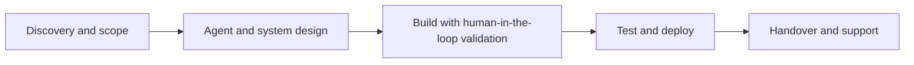
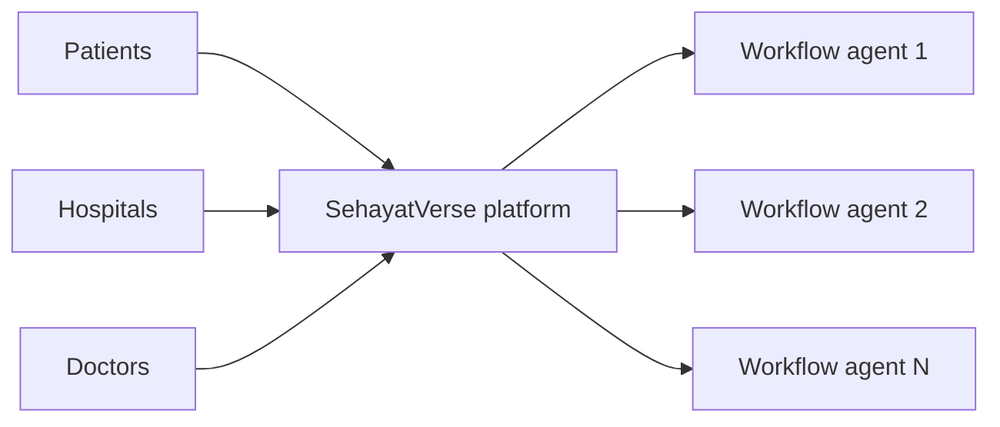
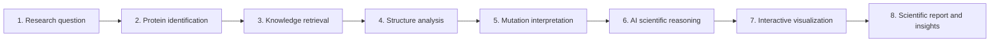

<!--
=====================================================================
 HOW TO USE (30 seconds)
 1. GitHub -> New repository -> name it EXACTLY:  ZareenFatima-tech
 2. Set it to Public and tick "Add a README file"
    (if the repo already exists: open README.md -> pencil icon)
 3. Select all, paste this file, then Commit
 4. Search for  [EDIT]  and update anything marked
 Delete this comment block when you are done.
=====================================================================
-->

 

  

---

## 👋 About me

I’m an **Agentic AI Engineer** with **4+ years** of experience designing, building and deploying **production-grade autonomous multi-agent systems** with LangChain, LangGraph, CrewAI and AutoGen.

I’m the **winner of the National Agentic AI Hackathon (Pakistan)**, have led a team of **7+ engineers across 10+ shipped AI products**, and work fluently with agentic coding tools (**Claude Code, Cursor, Antigravity, Bolt**) while keeping rigorous **human-in-the-loop validation**. I structure codebases and specifications so AI-generated output stays reliable and context-efficient, and I turn agentic workflows into measurable business impact.

- 🎓 Currently: **AI Instructor** at NAVTTC Centre of Excellence in Modern Technologies
- 🚀 Live products: **SehayatVerse** (telemedicine SaaS), **UniProtXplore** (protein intelligence SaaS) and **AI Smart Supervisor**
- 🤝 Open to: **AI engineering roles, freelance projects and collaborations**
- 💬 Ask me about: multi-agent orchestration, RAG pipelines, agentic coding workflows, deploying AI as SaaS

---

## 📈 Impact at a glance

| 🏆 | 👥 | 🚢 | 📉 | 🎯 | 🎓 |
|:---:|:---:|:---:|:---:|:---:|:---:|
| **Winner** National Agentic AI Hackathon | **7+** engineers led | **10+** AI products shipped | **40%** less client operational overhead | **60%** better RAG query relevance | **40+** trainees taught |

---

## 💼 What I do

| | Service | What you get |
|---|---|---|
| 🤖 | **Multi-agent systems** | Autonomous agent pipelines with tool calling, state and memory management, and human-in-the-loop checkpoints (LangGraph, CrewAI, AutoGen) |
| 🔎 | **RAG pipelines** | Retrieval systems grounded in your data using Pinecone, FAISS, ChromaDB or Weaviate, with measurable relevance gains |
| 🧩 | **AI SaaS products** | Full-stack Python SaaS with auth, billing and deployment, built around purpose-built agents, not one generic chatbot |
| 🎙️ | **Conversational and voice agents** | Chat and voice (TTS/STT) agents designed for real conversations and edge cases |
| 🧠 | **LLM integration and fine-tuning** | GPT-4, Mistral, LLaMA and Hugging Face models adapted to domain-specific tasks |
| 🚀 | **Deployment and MLOps** | FastAPI services, Docker, CI/CD and production-ready delivery |
| 🏫 | **AI training and mentoring** | Build-first Agentic AI/ML curriculum for teams and learners |

---

## 🧭 Professional experience

<b>🎓 AI Instructor · NAVTTC Centre of Excellence in Modern Technologies</b> &nbsp;|&nbsp; <i>Feb 2026 – Present</i>

 

- Designed and delivered a hands-on **Agentic AI/ML curriculum for 40+ trainees**, replacing lecture-based teaching with build-first labs covering the full pipeline from raw data to deployed, production-ready models.
- Trained **20+ engineers** to independently design, train, evaluate and deploy AI models using AI-augmented development practices rather than notebook-only prototyping.
- **Stack:** Python, TensorFlow/Keras, PyTorch, Scikit-learn, OpenCV, NLTK/spaCy, Flask/Streamlit, Git & GitHub.

<b>👩‍💻 Model Development Team Lead · AI Cadmey</b> &nbsp;|&nbsp; <i>Mar 2024 – Feb 2026</i>

 

- Led a cross-functional team of **7+ AI researchers and engineers** across **10+ shipped AI products**, directing architecture design, model development and production deployment end to end.
- Defined technical roadmaps and structured codebases and specifications to produce reliable, context-efficient AI-generated output, **reducing client operational overhead by 40%** by moving teams from manual workflows to automated, model-driven pipelines.
- Mentored junior researchers from theory-only backgrounds into independently owning full ML pipelines, from blank notebook to deployed product.

<b>🤖 AI Developer · Apna Khaiyal SMC Pvt. Ltd. (ApnaKhaiyal.com)</b> &nbsp;|&nbsp; <i>Jul 2025 – Nov 2025</i>

 

- Designed and deployed **RAG-based conversational agents** grounded in platform data, **improving query relevance by 60%** over the prior keyword-based search.
- Built a **voice interaction layer (TTS/STT)** enabling natural, agentic user interaction in place of manual navigation.
- Shipped multiple production AI agents, each engineered around a distinct user workflow rather than a single generic chatbot template.

<b>📊 Machine Learning Engineer · BuiltinSoft</b> &nbsp;|&nbsp; <i>Aug 2025 – Dec 2025</i>

 

- Cleaned and restructured fragmented, inconsistent business data into a reliable foundation for modeling and decision-making.
- Designed predictive models that shifted the business from reactive to forward-looking, data-driven decision-making.
- Automated workflows around model outputs so predictions actively drove day-to-day operational decisions instead of sitting unused in reports.

<b>🧠 AI Engineer · Deep Embed</b> &nbsp;|&nbsp; <i>Oct 2023 – Aug 2024</i>

 

- Delivered full-stack AI work spanning data science, ML/DL model development and NLP, taking projects from raw data to production-ready systems.
- Built and deployed production-grade **chatbots and RAG-based agents** engineered to handle real conversations and edge cases, not demo scripts.
- Fine-tuned and integrated **Hugging Face models** for domain-specific NLP tasks, prioritizing applied, shippable work over purely theoretical research.

<b>🦾 Robotics Intern · AI Cadmey (Robotics Lab)</b> &nbsp;|&nbsp; <i>Oct 2023 – Mar 2024</i>

 

- Learned embedded systems and circuit design fundamentals, then applied them across **two lab robotics projects** requiring real-time hardware–software integration.

---

## 🚀 Live SaaS products

### 🏥 SehayatVerse: AI-powered telemedicine and hospital management SaaS
**🔗 Live:** [sehayatverse.online](https://sehayatverse.online)

SehayatVerse is an AI-powered healthcare ecosystem that brings **telemedicine, chronic care and hospital management** into one platform. It connects **patients, hospitals, doctors and AI agents** across the **Middle East, Asia and other emerging markets**.

I architected it as a **multi-agent system**: each workflow is driven by its own **purpose-built AI agent** rather than a single generic chatbot, so every part of the care journey gets a tool designed for it.

**My role:** architect of the multi-agent platform

### 🧬 UniProtXplore: autonomous protein intelligence SaaS
**🔗 Live:** [uni-prot-xplore-frontend-4lnx.vercel.app](https://uni-prot-xplore-frontend-4lnx.vercel.app)

UniProtXplore is an **autonomous protein intelligence platform** for researchers. Protein data is scattered across many databases, and cross-referencing it by hand takes hours. Enter **one UniProt ID** and a multi-agent pipeline works through **eight stages**, pulling from **UniProt, PDBe, AlphaFold, ChEMBL, DrugBank and PubMed**, then reconciles everything into **one interpretation with a confidence score** instead of a table of raw data.

The analysis covers variant impact and stability shifts, druggable pockets and ligand binding, and PubMed evidence with Gene Ontology terms. Reports export as **FASTA and PDF**. It ships as a **tiered SaaS** (Free Trial, Lab Plan, Institution) with **Supabase-backed auth and billing**.

**My role:** designed and built the pipeline and the SaaS

**Five specialized agents:** Data Acquisition · Structure–Function Analysis · Chemical Interaction · Literature Intelligence · Insight Synthesis

### 🧠 AI Smart Supervisor
**🔗 Live:** [https://smart-supervisor-theta.vercel.app/]()

### Smart Supervisor — AI-Powered Academic Supervision

🔗 **Live Demo:** https://smart-supervisor-theta.vercel.app/

Smart Supervisor is an AI-powered academic supervision platform designed to help university students improve their Final Year Projects (FYPs) and help supervisors streamline project evaluation and guidance. It provides AI-assisted academic feedback, support for SRS/SDD documentation guidelines, and supervisor meeting requests in one platform.

**How it works:** Students use the platform to access AI-assisted project guidance, evaluate their documentation, and request supervisor meetings. The system is designed to support academic review and supervision workflows.

**My role:** AI Engineer & Project Developer

**Result:** Deployed a working web application currently being tested by university professors. Performance improvements and adoption metrics are not yet measured.

---

## 🌐 More live projects

<!-- [EDIT] Copy one row per live project. Keep each description to one sentence. -->

| Project | What it does | Stack | Live |
|---|---|---|---|
| **[EDIT: project name]** | [EDIT: one-sentence description] | [EDIT: e.g. LangGraph, FastAPI, Next.js] | [EDIT: https://your-live-link](https://your-live-link) |
| **[EDIT: project name]** | [EDIT: one-sentence description] | [EDIT: stack] | [EDIT: https://your-live-link](https://your-live-link) |

---

## 🧪 Open-source and learning projects

| Project | What it does | Stack | Link |
|---|---|---|---|
| 🏦 **Bank Statement Analyzer** | Turns bank statements into categorized spending, trends and summaries | Python, Pandas | [Code](https://github.com/ZareenFatima-tech/Bank-Statement-Analyzer) |
| 🪵 **Wooden Log Detection** | Detects and counts wooden logs in images | YOLOv8, PyTorch | [Code](https://github.com/ZareenFatima-tech/Wooden-log-Detection-system-using-Yolov8) |
| 🖼️ **Blind Face Restoration** | Restores degraded face images with a generative model | GFPGAN, PyTorch | [Code](https://github.com/ZareenFatima-tech/Realistic-blind-face-restoration-using-GFPGAN) |
| 😴 **Sleep Health Dashboard** | Interactive analysis of how lifestyle affects sleep quality | Python, data viz | [Code](https://github.com/ZareenFatima-tech/Sleep_health_lifestyle-dashboard) |

---

## 🛠️ Technical skills

| Area | Tools |
|---|---|
| **Agentic frameworks and orchestration** | LangChain, LangGraph, AutoGen, CrewAI, multi-agent pipelines, tool/function calling, state and memory management, human-in-the-loop design |
| **Agentic coding tools** | Claude Code, Cursor, Antigravity, Bolt, GitHub Copilot-style workflows |
| **LLM integration and fine-tuning** | GPT-4, Mistral, LLaMA, Hugging Face Transformers, prompt engineering, domain fine-tuning |
| **RAG and vector databases** | Pinecone, FAISS, ChromaDB, Weaviate, retrieval-augmented generation, semantic search |
| **API and backend** | FastAPI, REST API design and integration, Streamlit, Docker, Supabase |
| **ML / DL and data** | Python, TensorFlow/Keras, PyTorch, Scikit-learn, NumPy, Pandas, OpenCV, NLTK, spaCy |
| **DevOps and practices** | Git, GitHub, CI/CD, MLOps, Agile/Scrum, embedded systems |

<b>🧩 Core competencies</b>

 

Agentic workflow design · Multi-agent orchestration · Human-in-the-loop validation · AI-augmented development · Solution and systems architecture · Context-efficient prompt and spec design · RAG pipeline engineering · LLM fine-tuning and integration · Cross-functional team leadership · Full-stack Python development · Agile/Scrum delivery · Client and stakeholder communication

---

## 🏆 Honors and awards

- 🥇 **Winner, National Agentic AI Hackathon**, Pakistan
- 🥈 **2nd position, AI Expo 2024 (Tech Expo):** protein structure prediction and drug discovery using DeepMind AI
- 🏅 **Tech Expo Winner,** Cantonment, Bahawalpur

## 🎓 Education

- **BS, Artificial Intelligence**, The Islamia University of Bahawalpur
- **AI Engineer program**, NAVTTC Centre of Excellence in Modern Technologies

## 📜 Certifications and training

- Certificate in Artificial Intelligence, **Pakistan Engineering Council**
- Artificial Intelligence Engineer, **Silicon Valley, USA**
- Machine Learning Engineer, **AI Cadmey**
- Agentic AI, **Coursera**
- Web Scraping · Content Writing · Robotics Internship Certificate

---

## 📊 GitHub stats

<picture>
  <source media="(prefers-color-scheme: dark)" srcset="https://github-readme-stats.vercel.app/api?username=ZareenFatima-tech&show_icons=true&theme=tokyonight&hide_border=true&count_private=true">
  
</picture>
<picture>
  <source media="(prefers-color-scheme: dark)" srcset="https://github-readme-stats.vercel.app/api/top-langs/?username=ZareenFatima-tech&layout=compact&theme=tokyonight&hide_border=true">
  
</picture>

 

<picture>
  <source media="(prefers-color-scheme: dark)" srcset="https://streak-stats.demolab.com?user=ZareenFatima-tech&theme=tokyonight&hide_border=true">
  
</picture>

 

> ℹ️ These cards come from free public services. If one shows an error, refresh later.

---

## ❓ FAQ

<b>What kind of work are you open to?</b>

Agentic AI engineering roles, freelance multi-agent and RAG projects, AI SaaS builds, and training or consulting engagements.

<b>How do we start a project?</b>

Email me a short description of what you want to build. I’ll reply with questions and a rough plan.

<b>Do you work with AI coding tools?</b>

Yes. I use Claude Code, Cursor, Antigravity and Bolt to coordinate implementation across large codebases, with human-in-the-loop review at every important step.

---

## 🤝 Let’s work together

| | |
|---|---|
| 📧 **Email** | zareenfatima114@gmail.com · [write via Gmail](https://mail.google.com/mail/?view=cm&fs=1&to=zareenfatima114@gmail.com) |
| 💼 **LinkedIn** | [linkedin.com/in/zareen-fatima-596552283](https://www.linkedin.com/in/zareen-fatima-596552283/) |
| 🌐 **Portfolio** | [ZareenFatima-tech.github.io](https://ZareenFatima-tech.github.io) *[EDIT: use the exact portfolio link from your CV if different]* |
| 🏥 **SehayatVerse** | [sehayatverse.online](https://sehayatverse.online) |
| 🧬 **UniProtXplore** | [uni-prot-xplore-frontend-4lnx.vercel.app](https://uni-prot-xplore-frontend-4lnx.vercel.app) |

⭐ *If you like my work, a star on a repo goes a long way.* ⭐

