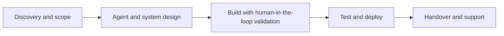
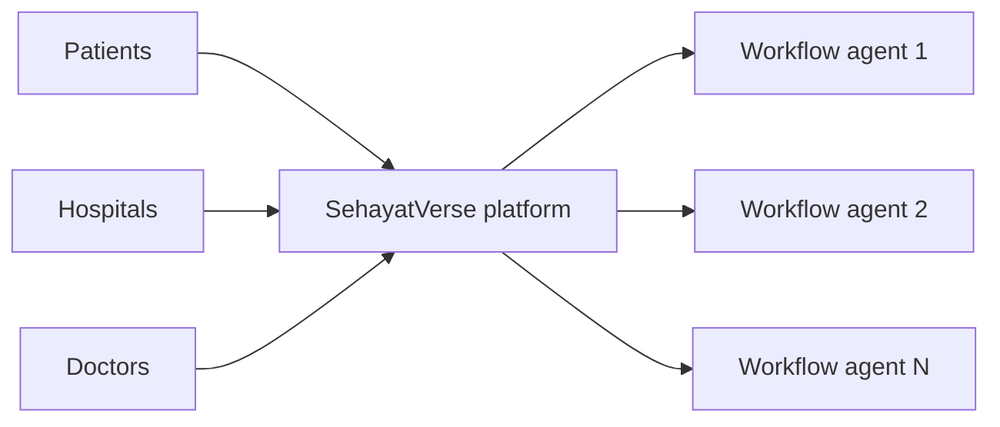
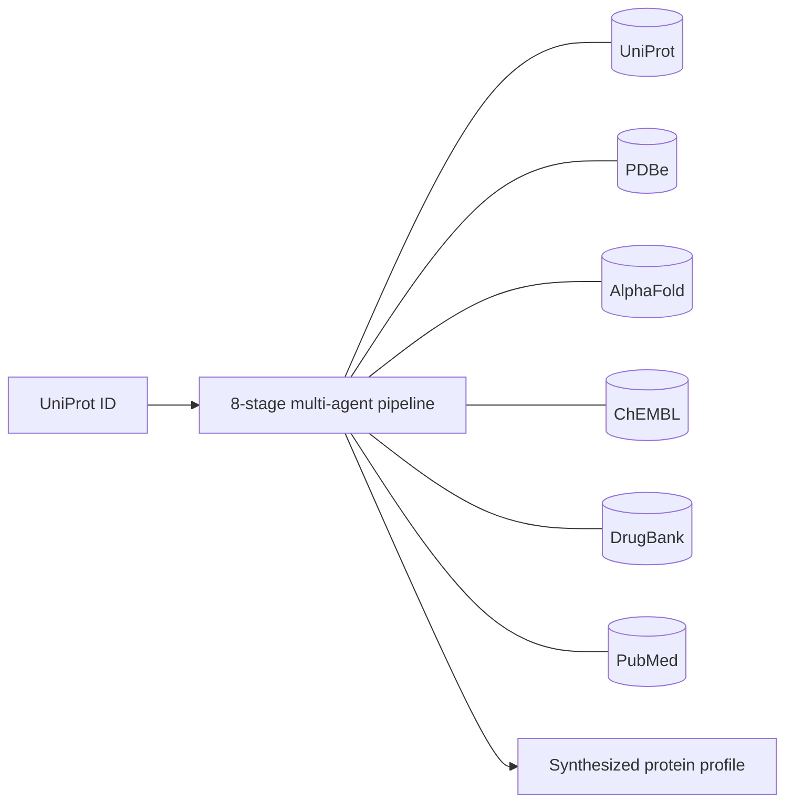
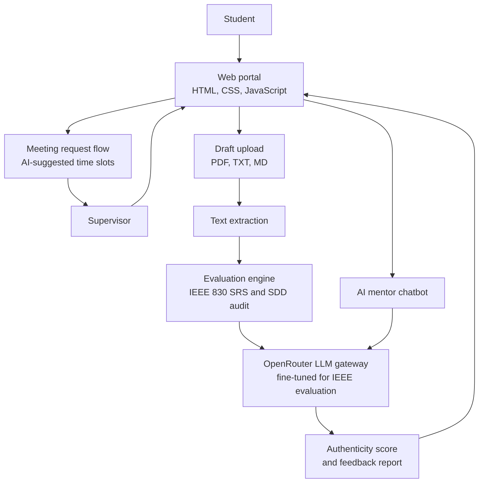
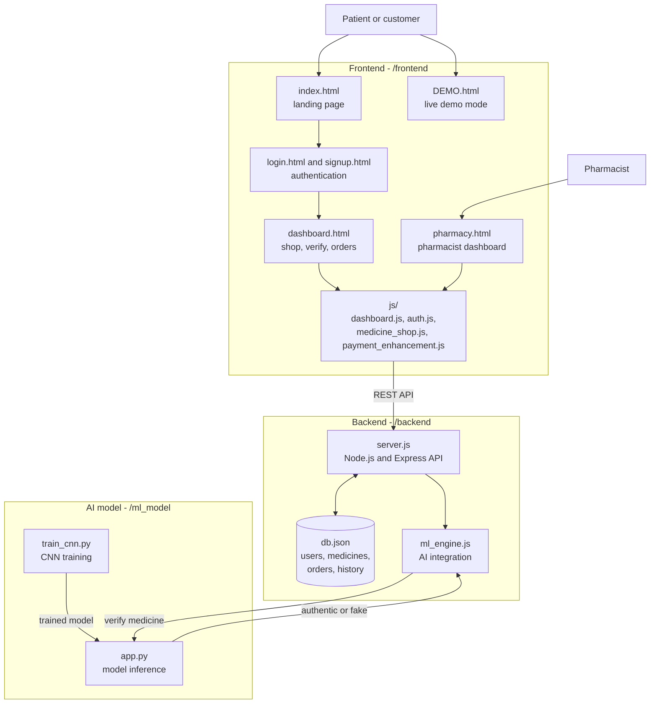
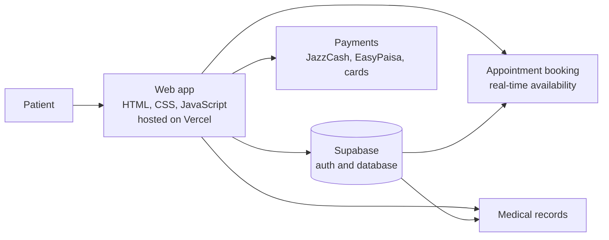

## 👋 About me

I’m an **Full Stack AI Engineer** with **3+ years** of experience designing, building and deploying **production-grade autonomous multi-agent systems** with LangChain, LangGraph, Genkit & Applied AI.

I’m the **winner of the National Agentic AI Hackathon (Pakistan) 2025**, have led a team of **7+ engineers across 10+ shipped AI products**, and work fluently with agentic coding tools (**Claude Code, Cursor, Kiro, Antigravity, Bolt**) while keeping rigorous **human-in-the-loop validation**. I structure codebases and specifications so AI-generated output stays reliable and context-efficient, and I turn agentic workflows into measurable business impact.

- 🎓 Currently: **AI Instructor** at NAVTTC Centre of Excellence in Modern Technologies
- 🚀 Live products: **SehayatVerse**, **UniProtXplore**, **Smart Supervisor**, **Autonomous Fake Medicine Detection** and **MediConnect**
- 🤝 Open to: **AI engineering roles, freelance projects and collaborations**
- 💬 Ask me about: multi-agent orchestration, RAG pipelines, agentic coding workflows, deploying AI as SaaS

---

## 📈 Impact at a glance

| 🏆 | 👥 | 🚢 | 📉 | 🎯 | 🎓 |
|:---:|:---:|:---:|:---:|:---:|:---:|
| **Winner**<br/>National Agentic AI Hackathon | **7+**<br/>engineers led | **10+**<br/>AI products shipped | **40%**<br/>less client operational overhead | **60%**<br/>better RAG query relevance | **40+**<br/>trainees taught |

---

## 💼 What I do

| | Service | What you get |
|---|---|---|
| 🤖 | **Multi-agent systems** | Autonomous agent pipelines with tool calling, state and memory management, and human-in-the-loop checkpoints (LangGraph, langChain, Embeddings, VectorDatabases) |
| 🔎 | **RAG pipelines** | Retrieval systems grounded in your data using Pinecone, FAISS, ChromaDB or Weaviate, with measurable relevance gains |
| 🧩 | **AI SaaS products** | Full-stack SaaS with auth, billing and deployment, built around purpose-built agents, not one generic chatbot |
| 🎙️ | **Conversational and voice agents** | Chat and voice (TTS/STT) agents designed for real conversations and edge cases |
| 🧠 | **LLM integration and fine-tuning** | GPT-4, Mistral, LLaMA, OpenRouter and Hugging Face models adapted to domain-specific tasks |
| 👁️ | **Computer vision and ML models** | CNN-based detection and classification, from training to an integrated product |
| 🚀 | **Deployment and MLOps** | FastAPI and Node.js services, Docker, CI/CD and production-ready delivery |
| 🏫 | **AI training and mentoring** | Build-first Agentic AI/ML curriculum for teams and learners |



---

## 🧭 Professional experience

<details open>
<summary><b>🎓 AI Instructor · NAVTTC Centre of Excellence in Modern Technologies</b> &nbsp;|&nbsp; <i>Feb 2026 – Present</i></summary>

<br/>

- Designed and delivered a hands-on **Agentic AI/ML curriculum for 40+ trainees**, replacing lecture-based teaching with build-first labs covering the full pipeline from raw data to deployed, production-ready models.
- Trained **20+ engineers** to independently design, train, evaluate and deploy AI models using AI-augmented development practices rather than notebook-only prototyping.
- **Stack:** Python, TensorFlow/Keras, PyTorch, Scikit-learn, OpenCV, NLTK/spaCy, Flask/Streamlit, Git & GitHub.

</details>

<details open>
<summary><b>👩‍💻 Model Development Team Lead · AI Cadmey</b> &nbsp;|&nbsp; <i>Mar 2024 – Feb 2026</i></summary>

<br/>

- Led a cross-functional team of **7+ AI researchers and engineers** across **10+ shipped AI products**, directing architecture design, model development and production deployment end to end.
- Defined technical roadmaps and structured codebases and specifications to produce reliable, context-efficient AI-generated output, **reducing client operational overhead by 40%** by moving teams from manual workflows to automated, model-driven pipelines.
- Mentored junior researchers from theory-only backgrounds into independently owning full ML pipelines, from blank notebook to deployed product.

</details>

<details>
<summary><b>🤖 AI Developer · Apna Khaiyal SMC Pvt. Ltd. (ApnaKhaiyal.com)</b> &nbsp;|&nbsp; <i>Jul 2025 – Nov 2025</i></summary>

<br/>

- Designed and deployed **RAG-based conversational agents** grounded in platform data, **improving query relevance by 60%** over the prior keyword-based search.
- Built a **voice interaction layer (TTS/STT)** enabling natural, agentic user interaction in place of manual navigation.
- Shipped multiple production AI agents, each engineered around a distinct user workflow rather than a single generic chatbot template.

</details>

<details>
<summary><b>📊 Machine Learning Engineer · BuiltinSoft</b> &nbsp;|&nbsp; <i>Aug 2025 – Dec 2025</i></summary>

<br/>

- Cleaned and restructured fragmented, inconsistent business data into a reliable foundation for modeling and decision-making.
- Designed predictive models that shifted the business from reactive to forward-looking, data-driven decision-making.
- Automated workflows around model outputs so predictions actively drove day-to-day operational decisions instead of sitting unused in reports.

</details>

<details>
<summary><b>🧠 AI Engineer · Deep Embed</b> &nbsp;|&nbsp; <i>Oct 2023 – Aug 2024</i></summary>

<br/>

- Delivered full-stack AI work spanning data science, ML/DL model development and NLP, taking projects from raw data to production-ready systems.
- Built and deployed production-grade **chatbots and RAG-based agents** engineered to handle real conversations and edge cases, not demo scripts.
- Fine-tuned and integrated **Hugging Face models** for domain-specific NLP tasks, prioritizing applied, shippable work over purely theoretical research.

</details>

<details>
<summary><b>🦾 Robotics Intern · AI Cadmey (Robotics Lab)</b> &nbsp;|&nbsp; <i>Oct 2023 – Mar 2024</i></summary>

<br/>

- Learned embedded systems and circuit design fundamentals, then applied them across **two lab robotics projects** requiring real-time hardware–software integration.

</details>

---

## 🚀 Live products

| Product | What it is | Live | Code |
|---|---|---|---|
| 🏥 **SehayatVerse** | AI telemedicine and hospital management SaaS | [sehayatverse.online](https://sehayatverse.online) | Private |
| 🧬 **UniProtXplore** | Autonomous protein intelligence SaaS | [Open app](https://uni-prot-xplore-frontend-4lnx.vercel.app) | Private |
| 🎓 **Smart Supervisor** | AI evaluation and supervision portal for final year projects | [Open app](https://smart-supervisor-theta.vercel.app/) | [GitHub](https://github.com/ZareenFatima-tech/Smart-Supervisor) |
| 💊 **Fake Medicine Detection** | Autonomous fake medicine verification system | [Open demo](https://fake-medicine-detection-mxg2-p4vdx14dr.vercel.app/) | [GitHub](https://github.com/ZareenFatima-tech/Fake-Medicine-Detection) |
| 🩺 **MediConnect** | Online clinic appointment booking for Pakistan | [Open app](https://medi-connect-pakistan.vercel.app/) | [GitHub](https://github.com/ZareenFatima-tech/MediConnectPakistan) |

---

### 🏥 SehayatVerse: AI-powered telemedicine and hospital management SaaS
**🔗 Live:** [sehayatverse.online](https://sehayatverse.online)

SehayatVerse is an AI-powered healthcare ecosystem that brings **telemedicine, chronic care and hospital management** into one platform. It connects **patients, hospitals, doctors and AI agents** across the **Middle East, Asia and other emerging markets**.

I architected it as a **multi-agent system**: each workflow is driven by its own **purpose-built AI agent** rather than a single generic chatbot, so every part of the care journey gets a tool designed for it.

**My role:** architect of the multi-agent platform



---

### 🧬 UniProtXplore: autonomous protein intelligence SaaS
**🔗 Live:** [uni-prot-xplore-frontend-4lnx.vercel.app](https://uni-prot-xplore-frontend-4lnx.vercel.app)

UniProtXplore is an **autonomous protein intelligence platform** for researchers. Protein data is scattered across many databases, and cross-referencing it by hand takes hours. Enter **one UniProt ID** and a multi-agent pipeline works through **eight stages**, pulling from **UniProt, PDBe, AlphaFold, ChEMBL, DrugBank and PubMed**, then reconciles everything into **one interpretation with a confidence score** instead of a table of raw data.

The analysis covers variant impact and stability shifts, druggable pockets and ligand binding, and PubMed evidence with Gene Ontology terms. Reports export as **FASTA and PDF**. It ships as a **tiered SaaS** (Free Trial, Lab Plan, Institution) with **Supabase-backed auth and billing**.

**My role:** designed and built the pipeline and the SaaS

**Five specialized agents:** Data Acquisition · Structure–Function Analysis · Chemical Interaction · Literature Intelligence · Insight Synthesis


```

---

### 🎓 Smart Supervisor: AI academic evaluation and FYP supervision portal
**🔗 Live:** [smart-supervisor-theta.vercel.app](https://smart-supervisor-theta.vercel.app/) · **💻 Code:** [GitHub](https://github.com/ZareenFatima-tech/Smart-Supervisor)

Smart Supervisor is an **AI-powered portal for university final year projects (FYP)**. Students upload a draft **SRS** (Software Requirements Specification, **IEEE 830**) or **SDD** (Software Design Document) as a PDF, text or Markdown file. The system extracts the text, **audits it against IEEE guidelines**, and returns an **authenticity score with actionable feedback**, so students can fix problems before they reach their supervisor.

It also includes an **AI mentor chatbot** that answers questions on IEEE 830, SDD architecture and how to improve a score, and a **meeting request flow** where students pick an AI-suggested time slot and set an agenda for a supervisor advisory meeting. It automates the IEEE SRS/SDD review work that supervisors normally do by hand.

**Tech stack:**     

**Architecture**



---

### 💊 Autonomous Fake Medicine Detection System
**🔗 Live:** [Open demo](https://fake-medicine-detection-mxg2-p4vdx14dr.vercel.app/) · **💻 Code:** [GitHub](https://github.com/ZareenFatima-tech/Fake-Medicine-Detection) · **My role:** Full Stack AI Engineer

Counterfeit medicine is a serious public health risk. This project is an **end-to-end system that helps people verify medicines and buy them safely**. Users sign up, **verify a medicine with an AI model**, browse a pharmacy shop, add items to a cart, pay at checkout and track their orders. Pharmacists get their own dashboard to **manage incoming orders**. A **"Launch Demo" mode** lets visitors try the platform without an account.

The app is a full stack: a multi-page JavaScript frontend, a **Node.js / Express** backend with a local JSON database for users, medicines, orders and history, and a **Python CNN model** for verification. The `ml_engine.js` module connects the backend to the Python model (or to a simulated model in demo mode).

**Tech stack:**       

**Architecture**



**How a verification works:** the user opens the dashboard and submits a medicine for verification → `dashboard.js` sends it to the API in `server.js` → `ml_engine.js` passes it to the Python CNN model → the result comes back to the dashboard and is saved to the user’s history.

---

### 🩺 MediConnect: online clinic appointment booking for Pakistan
**🔗 Live:** [medi-connect-pakistan.vercel.app](https://medi-connect-pakistan.vercel.app/) · **💻 Code:** [GitHub](https://github.com/ZareenFatima-tech/MediConnectPakistan)

MediConnect is a healthcare platform that makes **booking hospital and clinic appointments in Pakistan** simple. Patients can find doctors, **book appointments with real-time availability**, keep their **medical records** (history, prescriptions and test reports) in one place, and pay consultation fees through local options such as **JazzCash, EasyPaisa and debit cards**. Accounts and data run on a **Supabase** backend.

**Tech stack:**    



---

## 🧪 Open-source and learning projects

| Project | What it does | Stack | Link |
|---|---|---|---|
| 🏦 **Bank Statement Analyzer** | Turns bank statements into categorized spending, trends and summaries | Python, Pandas | [Code](https://github.com/ZareenFatima-tech/Bank-Statement-Analyzer) |
| 🪵 **Wooden Log Detection** | Detects and counts wooden logs in images | YOLOv8, PyTorch | [Code](https://github.com/ZareenFatima-tech/Wooden-log-Detection-system-using-Yolov8) |
| 🖼️ **Blind Face Restoration** | Restores degraded face images with a generative model | GFPGAN, PyTorch | [Code](https://github.com/ZareenFatima-tech/Realistic-blind-face-restoration-using-GFPGAN) |
| 😴 **Sleep Health Dashboard** | Interactive analysis of how lifestyle affects sleep quality | Python, data viz | [Code](https://github.com/ZareenFatima-tech/Sleep_health_lifestyle-dashboard) |

---

## 🛠️ Technical skills

<div align="center">


<br/><br/>


</div>

| Area | Tools |
|---|---|
| **Agentic frameworks and orchestration** | LangChain, LangGraph, AutoGen, CrewAI, multi-agent pipelines, tool/function calling, state and memory management, human-in-the-loop design |
| **Agentic coding tools** | Claude Code, Cursor, Kiro, Antigravity, Bolt, GitHub Copilot-style workflows |
| **Generative AI and LLM integration** | OpenAI (GPT-4), Mistral, LLaMA, OpenRouter, Hugging Face Transformers, Generative AI applications, prompt engineering, domain fine-tuning |
| **Automation** | Make.com workflow automation, tool and API integrations around AI agents |
| **RAG and vector databases** | Pinecone, FAISS, ChromaDB, Weaviate, retrieval-augmented generation, semantic search |
| **API and backend** | FastAPI, Node.js, Express, REST API design and integration, Streamlit, Docker, Supabase |
| **Frontend** | JavaScript, HTML, CSS |
| **ML / DL and data** | Python, TensorFlow/Keras, PyTorch, CNNs, Scikit-learn, NumPy, Pandas, OpenCV, NLTK, spaCy |
| **DevOps and practices** | Git, GitHub, CI/CD, MLOps, Vercel, Agile/Scrum, embedded systems |

<details>
<summary><b>🧩 Core competencies</b></summary>

<br/>

Agentic workflow design · Multi-agent orchestration · Human-in-the-loop validation · AI-augmented development · Solution and systems architecture · Context-efficient prompt and spec design · RAG pipeline engineering · LLM fine-tuning and integration · Cross-functional team leadership · Full-stack Python and JavaScript development · Agile/Scrum delivery · Client and stakeholder communication

</details>

---

## 🏆 Honors and awards

- 🥇 **Winner, National Agentic AI Hackathon**, Pakistan
- 🥈 **2nd position, AI Expo 2024 (Tech Expo):** protein structure prediction and drug discovery using DeepMind AI
- 🏅 **Tech Expo Winner,** Cantonment, Bahawalpur

## 🎓 Education

- **BS, Artificial Intelligence**, The Islamia University of Bahawalpur
- **AI Engineer program**, NAVTTC Centre of Excellence in Modern Technologies

## 📜 Certifications and training

- Certificate in Artificial Intelligence, **Pakistan Engineering Council**
- Artificial Intelligence Engineer, **Silicon Valley, USA**
- Machine Learning Engineer, **AI Cadmey**
- Agentic AI, **Coursera**
- Web Scraping · Content Writing · Robotics Internship Certificate

---

## 📊 GitHub stats

<div align="center">

<picture>
  <source media="(prefers-color-scheme: dark)" srcset="https://github-readme-stats.vercel.app/api?username=ZareenFatima-tech&show_icons=true&theme=tokyonight&hide_border=true&count_private=true">
  
</picture>
<picture>
  <source media="(prefers-color-scheme: dark)" srcset="https://github-readme-stats.vercel.app/api/top-langs/?username=ZareenFatima-tech&layout=compact&theme=tokyonight&hide_border=true">
  
</picture>

<br/>

<picture>
  <source media="(prefers-color-scheme: dark)" srcset="https://streak-stats.demolab.com?user=ZareenFatima-tech&theme=tokyonight&hide_border=true">
  
</picture>

<br/>


</div>

> ℹ️ These cards come from free public services. If one shows an error, refresh later.

---

## ❓ FAQ

<details>
<summary><b>What kind of work are you open to?</b></summary>

Agentic AI engineering roles, freelance multi-agent and RAG projects, AI SaaS builds, and training or consulting engagements.
</details>

<details>
<summary><b>How do we start a project?</b></summary>

Email me a short description of what you want to build. I’ll reply with questions and a rough plan.
</details>

<details>
<summary><b>Do you work with AI coding tools?</b></summary>

Yes. I use Claude Code, Cursor, Kiro, Antigravity and Bolt to coordinate implementation across large codebases, with human-in-the-loop review at every important step.
</details>

---

## 🤝 Let’s work together

| | |
|---|---|
| 📧 **Email** | zareenfatima114@gmail.com · [write via Gmail](https://mail.google.com/mail/?view=cm&fs=1&to=zareenfatima114@gmail.com) |
| 💼 **LinkedIn** | [linkedin.com/in/zareen-fatima-596552283](https://www.linkedin.com/in/zareen-fatima-596552283/) |
| 🌐 **Portfolio** | [ZareenFatima-tech.github.io](https://ZareenFatima-tech.github.io) |
| 🏥 **SehayatVerse** | [sehayatverse.online](https://sehayatverse.online) |
| 🧬 **UniProtXplore** | [uni-prot-xplore-frontend-4lnx.vercel.app](https://uni-prot-xplore-frontend-4lnx.vercel.app) |
| 🎓 **Smart Supervisor** | [smart-supervisor-theta.vercel.app](https://smart-supervisor-theta.vercel.app/) |

<div align="center">

⭐ *If you like my work, a star on a repo goes a long way.* ⭐


</div>
